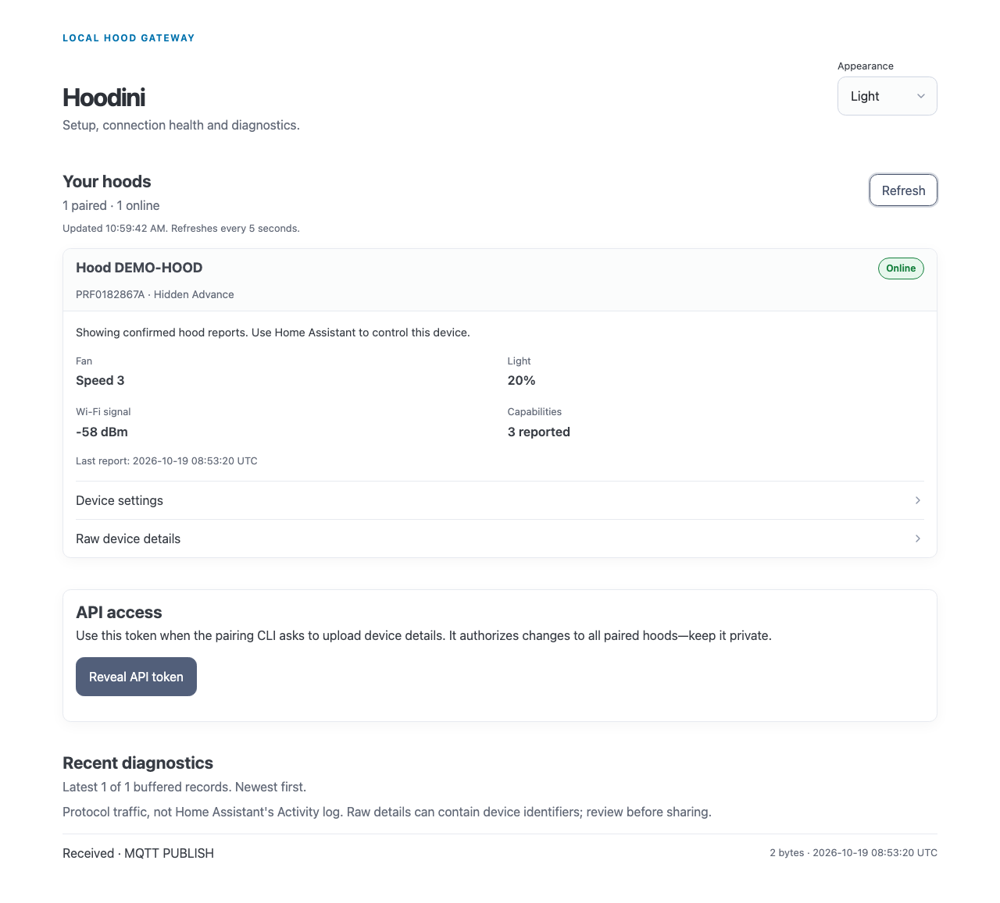

# Hoodini add-on

## Before you start

1. Install and configure an MQTT broker, such as the Mosquitto add-on.
2. Free host port **8883**: in Mosquitto's **Network** card, blank or remap its 8883 host mapping after checking any existing clients. Hoodini cannot change the hood's fixed TLS port.
3. Reserve a stable IPv4 address for the Home Assistant host in your router. The hood remembers it.

See [requirements](https://dmednis.github.io/hoodini/getting-started/requirements/) for the Bluetooth laptop and supported CPU architectures.

## Installation

1. [Add the Hoodini repository to Home Assistant](https://my.home-assistant.io/redirect/supervisor_add_addon_repository/?repository_url=https%3A%2F%2Fgithub.com%2Fdmednis%2Fhoodini).
2. In the add-on store, install **Hoodini**. Supervisor pulls the versioned multi-architecture image from `ghcr.io/dmednis/hoodini`.
3. Start the add-on and select **Open Web UI**. Success: the dashboard opens in Home Assistant. If it does not, check the add-on logs and [troubleshooting](https://dmednis.github.io/hoodini/reference/troubleshooting/).



## Configuration

Most users can leave options at their defaults. For a separate broker, the Configuration tab accepts:

```yaml
log_level: INFO
mqtt:
  url: mqtt://broker.example.com:1883
  username: example-user
  password: YOUR_PASSWORD
  tls: false
api:
  port: 8765
  interfaces: []
  addresses: []
```

An explicit `mqtt.url` does not inherit Supervisor MQTT credentials. A missing Supervisor MQTT service does not stop the gateway; configure the broker and restart the add-on. See the [configuration reference](https://dmednis.github.io/hoodini/reference/configuration/).

### Option: `log_level`

`DEBUG`, `INFO` (default), `WARNING`, `ERROR` or `CRITICAL`. Do not share raw debug logs.

### Option: `mqtt.url`

Leave unset to use Supervisor's MQTT service, or supply a URL with scheme and port (`mqtt://broker.example.com:1883` or `mqtts://broker.example.com:8883`).

### Option: `mqtt.username`

Optional username for an explicit broker URL.

### Option: `mqtt.password`

Optional password for an explicit broker URL. Do not paste it in reports.

### Option: `mqtt.tls`

Enable TLS for the external broker with a system-trusted certificate; default `false`.

### Option: `api.port`

LAN API port, default `8765`; this is not the fixed hood TLS port 8883.

### Option: `api.interfaces`

List of interfaces advertised to the pairing CLI. Normally empty (automatic).

### Option: `api.addresses`

List of addresses advertised to the pairing CLI. Normally empty (automatic).

## Pair your hood

1. On a trusted Bluetooth laptop, [install the pairing CLI from the release tag](https://dmednis.github.io/hoodini/getting-started/pairing/).
2. Open the dashboard and use **Reveal API token** when prompted; do not include it on a command line.
3. Put the hood into setup mode and run `hoodini pair`. Follow the [pairing guide](https://dmednis.github.io/hoodini/getting-started/pairing/) for the Wi-Fi and server prompts.

Success: after the first report (typically 3.5–5 minutes after command readiness), the hood appears in the dashboard and HA MQTT devices. If it fails, see [troubleshooting](https://dmednis.github.io/hoodini/reference/troubleshooting/).

## What you get in Home Assistant

| Entity | Purpose |
|---|---|
| Fan | Three speeds and boost on the Hidden Advance profile |
| Light | On/off and brightness |
| Filter and Wi-Fi sensors | Reported health and signal; some diagnostics are disabled by default |

See [Home Assistant entities](https://dmednis.github.io/hoodini/using/home-assistant/) for availability and the generic profile.

## Troubleshooting

- **Cannot start:** ensure Mosquitto no longer reserves host 8883; check existing broker clients first.
- **No MQTT entities:** configure the broker, restart Hoodini and wait for the hood's first status.
- **Cannot pair:** check 2.4 GHz Wi-Fi, the reserved server IPv4, LAN API 8765 and TLS 8883.

More in [troubleshooting](https://dmednis.github.io/hoodini/reference/troubleshooting/).

## Support

[File a bug](https://github.com/dmednis/hoodini/issues/new?template=bug.yml) or [report a hood model](https://github.com/dmednis/hoodini/issues/new?template=compatibility.yml). Redact identifiers, credentials and diagnostics before sharing.

## Disclaimer

Unofficial; not affiliated with or endorsed by Elica S.p.A.
